# DJAP user manual

DJAP (DJ Audio Processor) is a loudness and dynamics processor for Windows. It sits between a sound source and the
amplifier or recorder and makes every song come out at the same loudness, with a controlled sound and peaks that
never pass a set ceiling. This manual explains how to install it, connect it, and use every window, control and
setting. How the processing works inside is described in the separate technical manual (`DJAP-Technical-Manual.pdf`
in the installation folder; `docs/technical.md` on <https://github.com/hghaken/DJAP>).

This manual describes DJAP from version 0.1.96 on (the first version with updates from GitHub); the plug-in for DJ
software (chapter 9) came with the version after 0.1.100.

## Contents

1. [What DJAP does](#1-what-djap-does)
2. [Installing, updating and removing](#2-installing-updating-and-removing)
3. [Connecting DJAP](#3-connecting-djap)
4. [The main window](#4-the-main-window)
5. [The Setup window](#5-the-setup-window)
6. [Loudness presets and the loudness window](#6-loudness-presets-and-the-loudness-window)
7. [Colours and the colour window](#7-colours-and-the-colour-window)
8. [The analysis and spectrum windows](#8-the-analysis-and-spectrum-windows)
9. [The plug-in for DJ software](#9-the-plug-in-for-dj-software)
10. [Latency and real-time health](#10-latency-and-real-time-health)
11. [Updates](#11-updates)
12. [The command-line program DJAPCmd](#12-the-command-line-program-djapcmd)
13. [The settings file](#13-the-settings-file)
14. [Troubleshooting](#14-troubleshooting)
15. [Glossary](#15-glossary)

---

## 1. What DJAP does

DJAP has two independent stereo channels, **deck A** and **deck B**. In a DJ set-up each deck of the DJ software or
each channel of the mixer is sent through its own DJAP deck, so both decks are processed separately and come out at
the same loudness. For other use - for example everything Windows plays - DJAP can also run as **one channel**: one
stereo processor. The **plug-in** (chapter 9) brings the same processing into DJ software itself, one deck per
plug-in.

Each deck runs the same chain of processing stages:

| Step | What it does for you |
|---|---|
| **Leveller** | A slow, automatic hand on the volume: quiet and loud songs come out at the same loudness. It does not follow the music within a song and holds still during fades and pauses; a quiet part that stays (a soft verse, a breakdown) comes up to the target after a few seconds. |
| **Colour** | The tone of the music: bass, low-mid, presence and treble, an automatic tone correction per song, a sub-bass generator and a contour for quiet listening. |
| **Compressor** | Evens out the loud parts within a song. |
| **Density** | A multiband stage (1 to 7 frequency bands): a band that sticks out is turned down, one that falls away is lifted - the full, dense "radio" sound. |
| **Bass enhancer** | Overtones of the bass, so the bass is heard on small speakers. |
| **Exciter** | Overtones in the highs: shine and air. |
| **De-esser** | Takes the sharpness off "s" and "t" sounds. |
| **Stereo width** | A wider or narrower stereo image; the bass can be made mono. |
| **Soft clipper** | Rounds off the highest peaks, without delay. |
| **Limiter** | The safety net: the output never passes the ceiling (true peak, default -1 dBTP). |
| **Output gain** | A last trim, only downwards. |

What each step does and how much is set by the deck's **loudness preset** (the loudness and dynamics) and its **colour**
(the tone). DJAP ships with 8 loudness presets and 9 colours; every value can be changed and saved under your own name.

Things to know up front:

- **Low latency.** The only latency DJAP adds is the limiter's look-ahead: 1.5 ms by default (0, 1.5, 2, 3 or 5 ms), the same for
  both decks so they stay in time with each other when mixed.
- **Bypass is exact.** With a deck on Bypass its input goes out unchanged, bit for bit, delayed by the same
  look-ahead - so switching between processed and unprocessed never shifts the sound in time.
- **No clicks.** Every change - a loudness preset, a colour, a slider, a stage switched on or off - glides in over a few
  milliseconds. Starting and stopping the audio fade in and out.
- **Everything is saved at once.** There is no Save button: every change is stored in the settings file.

## 2. Installing, updating and removing

### 2.1 What you need

- Windows 10 or 11, 64-bit.
- For two decks: an audio interface with an **ASIO** driver and at least 4 inputs and 4 outputs (two stereo pairs
  each way).
- For one channel (Windows' own sound): any sound card. To run Windows' sound through DJAP you need a virtual audio
  cable, such as VAC (Virtual Audio Cable; the free Lite version is enough) - see 3.2.

No other software is needed: the programs carry their own runtime.

### 2.2 Installing

Run `DJAP-Setup-<version>.exe`. The setup is not signed, so Windows SmartScreen may warn before the first run
("More info", then "Run anyway").

The setup checks the computer first and shows what it found on the last page before installing:

- **Windows components** the programs use. If one is missing the setup stops and says which.
- **Media Foundation.** The "N" editions of Windows lack it. DJAP itself runs without it, but the command-line
  program DJAPCmd needs it to read MP3, M4A, WMA and FLAC files. The setup offers to add Microsoft's Media Feature
  Pack from Windows Update.
- **VAC.** Only needed for Windows' own sound with one channel. When it is missing the setup explains what it is for
  and can open its download page at the end. The setup never installs it.
- **ASIO drivers** found on the computer.

Options on the way:

- **Select Components**: *DJAP* (the program) and the *Plug-in for DJ software* (chapter 9); both are chosen by
  default, each can be left out.
- **Create a desktop shortcut** (off by default).
- **Start DJAP in the notification area when Windows starts, with the audio devices used last** (on by default).
  This can be changed later in the Setup window.

DJAP is installed in `C:\Program Files\DJAP`. Installing a newer version over an older one keeps all settings and
own loudness presets. If DJAP is running, the setup asks to close it first.

### 2.3 The first start

At the very first start no audio device has been chosen yet, so the **Setup window** opens by itself. Choose the
processing (two decks or one channel), the audio API and the devices, then press **Start audio** - see chapter 3 and
chapter 5.

### 2.4 The notification area

DJAP lives in the notification area (the icons next to the clock). Closing or minimising the main window hides it
there; **the audio goes on**. The first time this happens a message says so.

- **Click** the icon to show the window again.
- **Right-click** the icon for its menu: *Open DJAP*, *Setup...*, *About DJAP...*, *Shutdown*.
- The icon's tooltip shows whether the audio runs and each deck's loudness preset and colour (or "bypass").

DJAP really ends only with **Shutdown** (from the icon's menu or the main window's right-click menu), when Windows shuts
down, or when a setup closes it. Before it stops, the audio fades out over 10 ms, so there is no click.

Only one DJAP runs at a time: starting it a second time brings the running one to the front.

### 2.5 Starting with Windows

With "Start DJAP when Windows starts" on (Setup window, or the setup's option), DJAP starts hidden in the
notification area when you log on, and starts the audio with the devices of the last session if the audio was
running when it was last closed. Devices that are not ready yet right after logging on are tried again every 5
seconds for 2 minutes. If you stopped the audio before closing DJAP, it stays stopped at the next start.

Windows' own list of startup apps (Settings > Apps > Startup) can switch it off too; DJAP shows that as off.

### 2.6 Updating

DJAP checks once a day whether a newer version has been published and tells you; installing it takes one click.
See chapter 11.

### 2.7 Removing

Use Windows' Settings > Apps > Installed apps > DJAP > Uninstall. The uninstaller removes the programs, the
shortcuts and the "start with Windows" entry. It then asks whether to delete your settings and own loudness presets too
(`%APPDATA%\DJAP`); answer No to keep them for a later installation.

## 3. Connecting DJAP

### 3.1 DJ set-up with an ASIO interface (two decks)

DJAP needs the two decks as separate stereo signals and gives back two processed stereo signals:

```
deck A source -> interface inputs 1-2 -> DJAP deck A -> interface outputs 1-2 -> mixer / amplifier
deck B source -> interface inputs 3-4 -> DJAP deck B -> interface outputs 3-4 -> mixer / amplifier
```

The channel pairs can be chosen freely in the Setup window (any input pair and any output pair per deck, as long as
the two decks use different output pairs).

Where to take the deck signals from:

- **Before the channel fader and crossfader (pre-fader)** is best: the leveller then settles on a song while you
  pre-listen, and your fader moves are not "corrected".
- **After the fader** also works: the leveller's hold rule keeps fades and cuts from being pumped up, but it is
  never as clean as pre-fader.

EQ kills and filter sweeps look like level changes to the leveller. Deep cuts are caught by its hold rule; with
lighter EQ moves the leveller may make up part of the cut over a few seconds. A slower leveller (loudness window,
Leveller > Speed) makes that less noticeable.

**An ASIO driver usually serves one program at a time.** If your DJ software uses the same interface through ASIO,
DJAP may not be able to open it, or opening it may take the interface away from the DJ software. Use a second
interface, or route the DJ software's deck outputs to the inputs DJAP reads through the interface's own mixer
software. DJAP always asks before it opens a driver.

### 3.2 Windows' own sound (one channel)

To process everything Windows plays (browser, music player, video):

1. Install a virtual audio cable (VAC). It adds a playback device ("Line 1") and a recording device of the same name
   connected to it.
2. Make the cable's playback device the **default playback device** in Windows' sound settings. All Windows sound now
   goes into the cable.
3. In DJAP's Setup window choose **Processing: One channel**, **Audio API: WASAPI**, as **Input** the cable's recording
   device and as **Output** your speakers or headphones.
4. Press **Start audio**.

With one channel, the outputs follow the Windows volume by default (the keyboard's volume keys and the taskbar
slider), after the processing - see 5.2. Without this, the volume keys would turn down the cable and the leveller
would turn it back up.

You can also keep an ASIO interface as the output and take the input from a WASAPI device: choose **Audio API: ASIO**
and **Input from: WASAPI devices** (see 5.1, "Deck inputs"). The two devices run on separate clocks; DJAP corrects
the drift between them at the cost of a buffer (about 15-25 ms with a 10 ms WASAPI input, by the ASIO buffer size;
less with a shorter *Input period*; see chapter 10).

### 3.3 Which audio API?

| API | Latency | Use it for |
|---|---|---|
| **ASIO** | lowest | Audio interfaces with an ASIO driver; the only API where both decks run in one synchronous stream. Best for DJs. |
| **WASAPI** shared | low to medium | Windows' own audio system, shared with other programs. Each deck has its own input and output device. |
| **WASAPI** exclusive | low | As shared, but DJAP takes the devices for itself while the audio runs (DJAP asks first). |
| **DirectSound**, **MME** | higher | Older interfaces; for devices without a good driver. |

With every API the processing itself adds only the limiter look-ahead; the rest of the latency is the devices'
buffers (chapter 10).

With WASAPI, DirectSound and MME a deck's input and output device usually run on clocks of their own (a virtual
cable and a USB headset, a recording device and the PC's speakers), and two clocks always drift apart a little. With
**Drift correction** (Setup window) on *Auto*, the default, DJAP reads the input a little faster or slower - at most
0.2 %, inaudible - so they never drift apart, at the cost of a buffer of about 8 ms (128-frame periods) to 23 ms
(10 ms periods), shown while running. With WASAPI an input and output of the same device (one clock, for example the
inputs and outputs of one USB interface) are recognised and run without the buffer, as one stream - 5 to 13 ms less.
Should such a device still give a short glitch now and then, choose *Always*: then it is corrected too. *Off*: the
input always goes straight to the output with no buffer, and devices on different clocks give a short glitch now and
then.

### 3.4 Test safely

Opening a driver or a device in exclusive mode takes it from other programs, and outputs you think are silent may
still be routed to speakers. For a first test, use outputs nobody listens to, start with a low volume on the
amplifier, and watch the meters before you turn up.

### 3.5 Sample rate, bit depth and the virtual cable

Two numbers describe digital audio:

| | Sample rate (for example 44,100 or 48,000 Hz) | Bit depth (for example 16 or 24 bits) |
|---|---|---|
| What it is | How often per second the signal is measured | How finely each measurement is stored |
| What it sets | The highest frequency that can pass: half the rate | How far the noise floor lies under full scale: about 6 dB per bit |
| 44.1 kHz / 16 bits | up to 22.05 kHz | about 96 dB |
| 48 kHz / 24 bits | up to 24 kHz | about 144 dB in theory (real converters reach 110-120 dB) |
| Audible difference? | No: hearing ends around 16-20 kHz | Only when the sound is turned down and later up again along the way |

**Sample rate: one rate through the whole chain.** 44.1 and 48 kHz both cover all you can hear; the difference
between them is inaudible. What can be heard is a conversion between rates: every device or program that runs at
another rate than the music resamples it, and a simple resampler (the virtual cable's own is linear) dulls the
highest tones or adds faint tones that do not belong to the music. Choose the rate of your music - 44.1 kHz for CDs
and most MP3s, 48 kHz for video - and set it everywhere: the player or DJ software, Windows' default format of the
cable (both its playback and its recording device), the cable's format range, and DJAP's Setup window. Higher rates
(88.2 or 96 kHz) are not needed for DJAP: the soft clipper and the exciter already work at 2 to 8 times the rate
inside (5.1, Oversampling). At the same buffer size in frames a higher rate gives a little less latency in
milliseconds, but the difference is tiny (64 frames: 1.45 ms at 44.1 kHz, 1.33 ms at 48 kHz).

**Bit depth: 24 bits on the cable.** As a final format 16 bits is enough - a CD's noise lies 96 dB under full scale.
The trouble is a level that is turned down along the way and up again later: the noise of 16 bits comes up with it.
With Windows' sound through a virtual cable that happens: the Windows volume turns the sound down before the cable
(at 30 % by roughly 20 dB), DJAP undoes that at its input when the outputs follow the Windows volume (5.2), and the
leveller may lift a quiet passage by up to 12 dB more. In 16 bits the noise floor can then come up from -96 to
about -65 dB, audible in quiet passages, fades and breaks. With 24 bits it starts about 48 dB lower and stays far
under hearing. DJAP itself computes in 32-bit floating point and asks Windows for 32-bit floating-point samples;
nothing is lost there. The virtual cable carries no floating-point formats: 24 bits is its best.

The virtual cable's settings, step by step and with pictures, are in 3.6.

### 3.6 Setting up the virtual cable (VAC), step by step

A virtual cable brings sound from one program to another inside the computer: what a player or Windows plays into
the cable's **playback** device comes out of its **recording** device, where DJAP picks it up. VAC (Virtual Audio
Cable) adds one or more such cables, called *Line 1*, *Line 2* and so on. The Lite version has one cable; the full
version more - two decks from one DJ program that sends each deck to its own output need two.

The settings below were measured with DJAP: a 1 kHz tone through the cable, recorded at each setting (chapter 10
and the technical manual, 17).

**Step 1 - VAC's Control Panel.** Start *VAC Control Panel* from the Start menu (*Virtual Audio Cable*), as
administrator (right-click: *Run as administrator*) - a change of the number of cables restarts the driver, which
needs it. Stop DJAP's audio and the player first: most cable settings cannot change while the cable is in use. Click
the cable in the list (for example cable 1), set the values in the *Cable* group as in the table, and click **Set**
in that group.

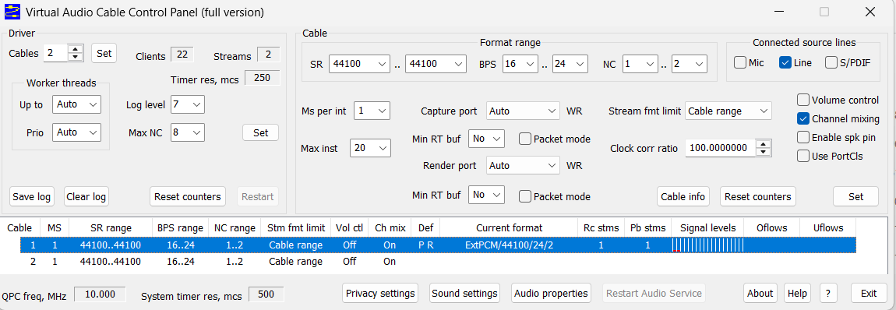

| Setting | Choose | Why |
|---|---|---|
| **Cables** (Driver group) | as many as you need, usually 1 or 2 | each cable is a pair of Windows devices; more than needed only slows Windows' device lists |
| **SR** (format range) | your music's rate at both ends, for example 44100 .. 44100 | one rate, so nothing in the cable or in Windows has to convert (3.5) |
| **BPS** (format range) | 16 .. 24 | the cable may carry 24 bits; it has no floating-point formats, so 24 is its best (3.5) |
| **NC** (format range) | 1 .. 2 | stereo |
| **Ms per int** | **3** with DJAP's *Input period* at Windows' 10 ms or 8 ms; **1** for 6, 5 or 4 ms | the cable's own timer: it fills its buffer this often. DJAP's input period must span 3-4 ticks of it - measured: at 3 ms an 8 ms period or longer is clean, at 1 ms 4 ms or longer; shorter periods click or sound distorted. 1 gives the system more timer work: use it only for a short input period |
| **Max inst** | leave it (20) | how many programs may open the cable at once |
| **Capture port / Render port** | Auto (it shows **WR**: WaveRT) | the most efficient kind, with notification events - what Windows' low-latency mode needs |
| **Min RT buf** | No | a minimum buffer for programs that talk to the driver directly; it does not affect Windows' audio engine, which DJAP uses |
| **Packet mode** | off (both) | on, it guards against lost data but makes the driver report false over- and underflows when the margin is short, and the resynchronisation clicks |
| **Stream fmt limit** | Cable range | streams may use only the formats set above |
| **Clock corr ratio** | 100.0000000 | DJAP measures and corrects the drift between the cable and the output itself; a second correction would work against it |
| **Volume control** | off | the samples pass unchanged (bit for bit) and it costs no CPU |
| **Channel mixing** | on | the standard conversion when a program plays mono into a stereo cable |
| **Enable spk pin**, **Use PortCls** | off | not needed |
| **Worker threads**: Up to, Prio (Driver group) | Auto, Auto | the driver's own choice per processor |

**Step 2 - Windows' Sound settings.** Open *Sound settings* (the button in VAC's panel, or right-click the speaker
in the taskbar) and then *More sound settings* for the classic Sound dialog.

- On the **Playback** tab, double-click the cable (*Line 1 (Virtual Audio Cable)*), tab **Advanced**: *Default
  Format* **24 bit, 44100 Hz (Studio Quality)** - or the rate of your music. Leave the two *Exclusive Mode* boxes on.
  On the tab *Enhancements* (if it is there): all off.

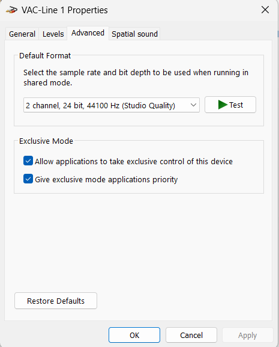

- On the **Recording** tab, double-click the same cable, tab **Advanced**: the same format, **24 bit, 44100 Hz**.
  Tab **Listen**: *Listen to this device* **off** - on, Windows plays the cable to the speakers itself as well, and
  you hear everything twice (once without DJAP's processing).

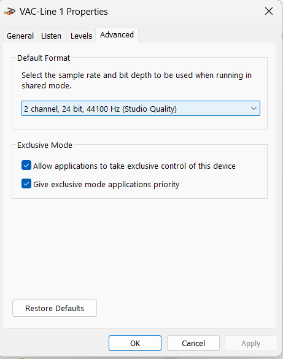

- For **Windows' own sound** through DJAP (one channel, 3.2): make the cable's playback device the **default
  playback device** (right-click it: *Set as Default Device*). For a **player or DJ software**: choose the cable as
  that program's output instead, and keep your normal default device.

**Step 3 - DJAP's Setup window.** With an ASIO interface for the output:

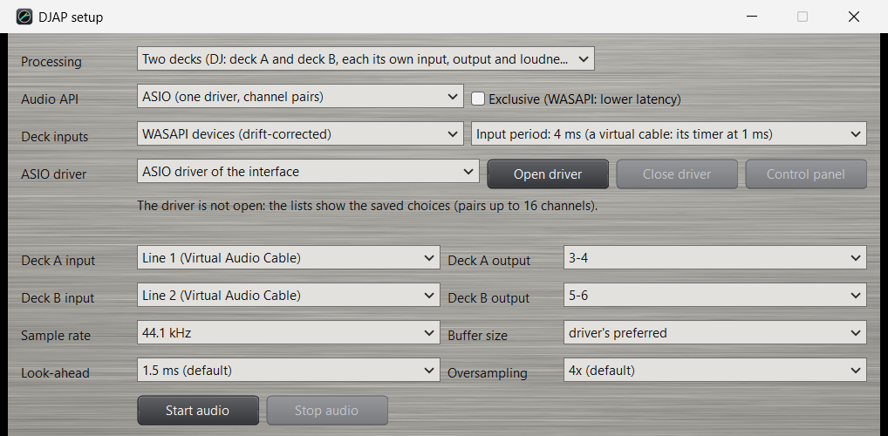

1. **Audio API: ASIO**, the interface's driver.
2. **Deck inputs: WASAPI devices (drift-corrected)**; as each deck's input the cable's recording device (*Line 1
   (Virtual Audio Cable)*; with two cables deck B on *Line 2*).
3. **Input period**: *Windows' default (10 ms)* is always safe. With **Ms per int 1** in VAC, **4 ms** saves about
   12 ms of latency; with **Ms per int 3**, at most **8 ms** (saves about 4 ms).
4. **Sample rate**: the same as in steps 1 and 2. **Buffer size**: the interface's preferred one, 64 or 128 frames
   for low latency.
5. **Start audio**.

Without an ASIO interface (WASAPI as the whole route): **Audio API: WASAPI**, each deck's input the cable's
recording device and its output the speakers; *Drift correction* on *Auto* (3.3).

**Step 4 - Check.**

- In VAC's panel the cable's row shows *Current format* **ExtPCM/44100/24/2** (the format in use), *Rc stms* and
  *Pb stms* 1 or more (DJAP recording, the player playing), and empty **Oflows / Uflows** columns. Counts there mean
  the cable was not served in time.
- In DJAP's Setup, **Health**: per deck the latency, *input* about the chosen period (4.0, 8.0 or 10.0 ms), the drift
  in ppm (tens of ppm are normal: the cable and the interface run on clocks of their own), and **underruns 0**. Two
  messages can appear: "the input still comes in 10 ms blocks" (Windows' short periods need the cable at the same
  rate in Windows as the interface) and "N input blocks came twice" (the cable's timer is too slow for the period:
  choose a longer period, or Ms per int 1).
- Press **Reset counters** and let it run while you listen; after half an hour *underruns* and *late* should still be 0.

**When something is wrong**

| What you notice | Cause | What to do |
|---|---|---|
| Distorted or crackling sound right after choosing a short input period | the cable's timer is slower than the period needs | Ms per int 1 in VAC, or a longer input period (8 or 10 ms) |
| Everything twice, once unprocessed | *Listen to this device* is on for the cable's recording device | turn it off (step 2) |
| DJAP's input shows "(not found)" | the cable was renamed, reinstalled, or chosen under another API | choose it again in Setup |
| Muffled highs, or noise in quiet passages | the cable at 16 bits, or another rate than the music | steps 1 and 2: 24 bits, the music's rate everywhere |
| Counts in VAC's *Oflows* / *Uflows* | a program did not keep up with the cable | they may appear when a stream starts or stops; growing counts while playing: a longer input period |

## 4. The main window

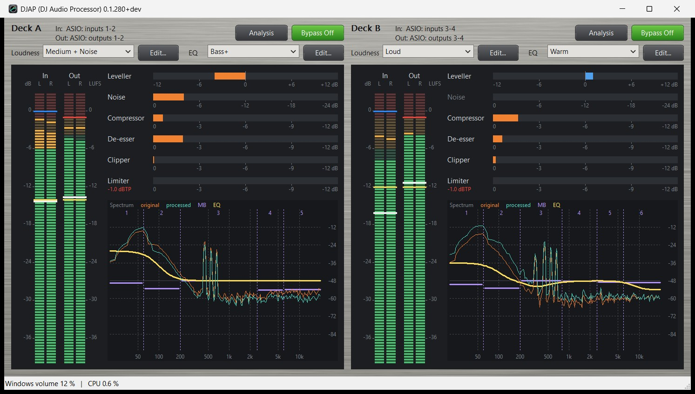

The main window shows one strip per deck (one strip, "Channel", over the whole width with one channel). The window has
no menu bar: **right-click anywhere in it** for *Setup...*, *About DJAP...* (the version, the settings file in use,
the licences, the updates and a link to DJAP's GitHub page - source, releases and manuals) and *Shutdown*. Every control has a tooltip that explains it
when the mouse rests on it. The window can be made as large as you like; it cannot be made smaller than the size
that still shows every meter row and a readable spectrum.

### 4.1 The deck strip

- **Title row.** The deck's name and its route on two lines, for example `In: ASIO: inputs 1-2` above `Out: ASIO:
  outputs 1-2`, or with other APIs the device names (a name too long for the window ends in "..."; the Setup window
  shows it whole). With linked presets deck B shows "linked to deck A".
- **Graphs** opens the analysis window (8.1).
- **Bypass.** Lit (green): the deck's input goes out unchanged, delayed by the look-ahead. Not lit: the deck is
  processed. Saved per deck.
- **Loudness** and its **Edit...** button: the deck's loudness preset (the loudness and dynamics) and the loudness window
  (chapter 6). The list runs from the quietest output to the loudest; your own loudness presets are sorted in.
- **Colour** and its **Edit...** button: the deck's colour (the tone) and the colour window (chapter 7).

A new loudness preset or colour is heard at once, without a click.

### 4.2 The bass settings

Four settings for the most-used bass values, in the spectrum window (8.2: a click on the meter panel's spectrum
opens it) as sliders - the bass level and frequency also as the blue point in its graph - and in the plug-in's window (9). They change the loudness preset or the colour itself, so every deck using that
loudness preset or colour changes with it. A change is heard while dragging and saved when the slider is let go. Arrow keys and
Page Up / Page Down step the slider that has the focus.

| Slider | Range | What it does | Belongs to |
|---|---|---|---|
| **Bass level** | -12 .. +12 dB | More or less bass below the bass frequency (the colour's bass shelf). The leveller keeps the loudness, so this changes the balance, not the volume. 0 dB = off. | colour |
| **Bass enhancer** | 0 .. 100 % | Strength of the bass overtones, so the bass is heard on small speakers. 0 % switches the enhancer off; more switches it on. | loudness preset |
| **Bass width** | 0 .. 100 % | Stereo width of the bass: 0 % = bass in mono (tighter in a club, safe on mono systems), 100 % = as recorded. Moving it switches the stereo-width stage on. | loudness preset |
| **Bass frequency** | 40 .. 250 Hz | Where "bass" ends for the three sliders above: the colour's bass corner and, within their own ranges, the enhancer's frequency (60-160 Hz) and the width stage's bass split. Each can be set separately in the loudness preset and colour windows. | both |

### 4.3 The meter panel

The dark panel under the Loudness and Colour lists shows what the deck is doing.

**LED bars, left.** *In L / R* is the input level (sample peak in dBFS, including the loudness preset's input gain); *Out L /
R* is the output level (true peak in dBTP). Lit segments show the level; the zone colours show amber and red near the
top (input: amber from -6, red from -1 dBFS; output: amber in the last 3 dB below the ceiling, red above it). A
single LED holds the peak for 1.5 s. Across each pair a **white** line shows the momentary loudness and a **yellow**
line the target loudness. The scale on the left is in dB, the one on the right in LUFS; they share one axis, so the
white line can be compared with the bars and with the target directly.

**Stage rows, right.** What each stage does now:

- **Leveller** - its gain, up (right of 0) or down (left), over its range.
- **Compressor**, **De-esser**, **Clipper**, **Limiter** - gain reduction, 0 to 12 dB.

A stage that is switched off in the loudness preset is shown greyed out.

**Spectrum.** The frequency content of the input (**original**, orange) and the output (**processed**, turquoise),
20 Hz to 20 kHz. The density stage is drawn in it: its bands (dotted lines at the splits, band numbers at the top)
and each band's gain now as a line over the band's range (purple, like the bands), up or down by up to 12 dB. The **colour**
(yellow) is the deck's colour as one EQ curve on the same scale, the auto tone's corrections of the moment included
(its points and per-section curves are in the spectrum window, 8.2); in Bypass it is not drawn.

**Clicking in the panel** opens the setting behind it: a stage row opens the loudness window on that stage's tab, the
In bars open the General tab (input gain, target), the Out bars the Limiter tab (ceiling), the spectrum the spectrum
window (8.2).

### 4.4 The status bar

The Windows volume (or "muted") and DJAP's CPU use, as a share of the whole computer as Task Manager shows it (two
decks take a few percent of one processor core, so well under 1 % on a computer with many cores). While the audio
runs, then *audio X % of core N*: the processing's share of the one core the audio thread runs on, averaged over a
second, and which core that is - with "(P-core)" or "(E-core)" on a processor with both kinds (Windows may move the
thread between cores; the number is where the last period ran). With WASAPI each deck has its own thread: the share
is that of both together, the core deck A's. This share against 100 % is the room left; the Health section's
*heaviest* shows the worst single period. After them, only
when there is one: an error, a start that is being retried, a settings file that could not be saved, a new version.
The audio's state - devices, sample rate, buffer size, latency, drift, the health counters - is in the Setup window
(chapter 5).

### 4.5 Linked presets

With "Deck A and deck B use the same loudness preset and colour" on (Setup window), the main window shows one set of controls - deck A's
loudness preset, colour, Edit buttons and Bypass - and they count for both decks (the spectrum window's bass sliders
too). Deck B's strip shows only its route
and its meters.

## 5. The Setup window

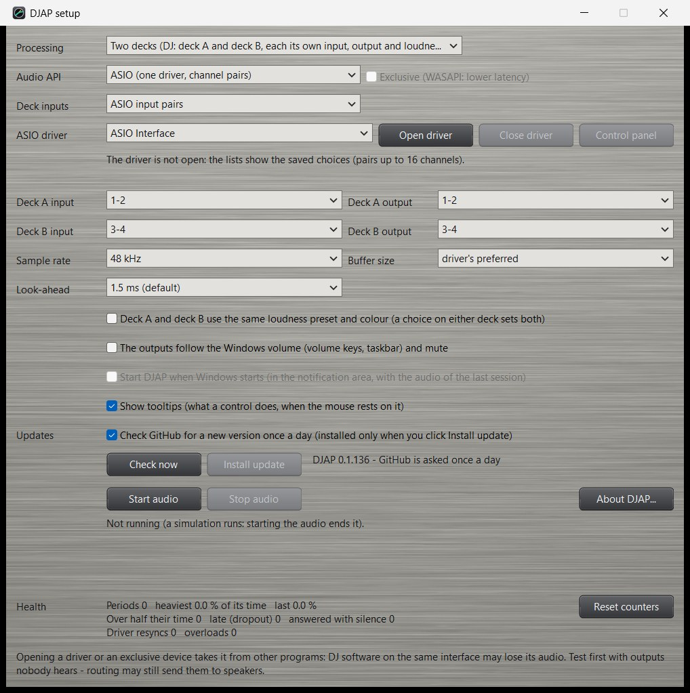

Right-click the main window (or the notification-area icon) and choose **Setup...**. Every choice is saved at once.
While the audio runs, a new device, channel pair, sample rate, buffer size or input API is applied at once by starting
the audio again (a short fade-out and fade-in).

### 5.1 Audio

| Row | What it does |
|---|---|
| **Processing** | *Two decks* (deck A and deck B, each its own input, output and loudness preset) or *One channel* (one stereo processor, for example for what Windows plays). |
| **Audio API** | ASIO, WASAPI, DirectSound or MME (see 3.3). Choosing another API stops the audio. **Exclusive** (WASAPI only): lower latency, but the devices are taken from other programs while the audio runs. |
| **Drift correction** (WASAPI, DirectSound, MME) | *Auto* (default): each deck's input is read a little faster or slower so that an input and output device on different clocks never drift apart; adds a buffer of about 8-23 ms (smaller with a smaller buffer size). WASAPI leaves an input and output of the same device as one stream without it. *Always*: also those. *Off*: no buffer, but a glitch now and then unless input and output are the same device (see 3.3). Changing it while the audio runs starts the audio again. |
| **Deck inputs** / **Input from** (ASIO only) | Where the decks' inputs come from: *ASIO input pairs*, or devices of WASAPI, DirectSound or MME (drift-corrected; adds a buffer of about 15-25 ms with a 10 ms input, by the ASIO buffer size). The outputs stay ASIO. |
| **Input period** (ASIO with WASAPI inputs; in the place of Drift correction) | How often Windows hands over the input's sound. *Windows' default (10 ms)*, the default. *8, 6, 5 or 4 ms*: through Windows' low-latency mode - the period counts twice (the input's own latency and the drift buffer), so they save about 4, 8, 10 or 12 ms. It needs a device that has that mode, set in Windows' sound settings (*Advanced*) to the same sample rate as the ASIO interface; otherwise the input keeps 10 ms, and the Health section then says "the input still comes in 10 ms blocks". When the device runs another length than chosen (its own step), Health shows both; when the same input block arrives twice - the device read faster than it is filled - Health counts it and advises a longer period or a faster cable timer. A virtual cable's own timer must tick at least 3-4 times per period - measured with a tone through the cable: with its timer at 3 ms (VAC: *Ms per int*) clean from 8 ms, at 1 ms clean from 4 ms; shorter periods give clicks and distorted sound (see 3.5). The input's latency in Health is the block size measured as it arrives. `DJAPCmd --devices` lists the periods Windows allows each input. Try it while you listen and watch the underruns; changing it while the audio runs starts the audio again. |
| **ASIO driver** | The installed ASIO drivers. **Open driver** opens it (DJAP asks first: it may take the interface from other programs); **Close driver** releases it; **Control panel** opens the driver's own settings (buffer size, clock source). Under it: the driver's state. |
| **Deck A / B input**, **output** | ASIO: a channel pair per deck, with the driver's channel names once it is open. Other APIs: an input and an output device per deck; *(none)* = the deck does not run. A saved device that is not connected shows "(not found)". |
| **Sample rate** | 44.1, 48, 88.2 or 96 kHz. ASIO uses this rate if the driver accepts it, else the interface's own rate. Other APIs convert when a device runs at another rate. |
| **Buffer size** | ASIO: the driver's preferred size, or a size it allows. Other APIs: the period asked of Windows. Smaller = less latency, more risk of dropouts (watch Health). |
| **Look-ahead** | The limiter's look-ahead: 0, 1.5 (default), 2, 3 or 5 ms, the same for both decks. Longer handles peaks more gently. Every choice above 0 limits the true peak; at 0 ms the limiter holds only the sample peak (true peaks can pass the ceiling) and adds no delay. Changed at once with a short fade. (The former 0.5 and 1.0 ms were too short for the true-peak detector and are now 1.5 ms.) |
| **Oversampling** | 2x, 4x (default) or 8x, both decks: how many times the sample rate the soft clipper and the exciter work at. Their overtones above the audio band would fold back as harsh tones that do not belong to the music; 2x leaves a rest on hard-driven high tones (about 40 dB under a 15 kHz tone), 4x and 8x take it away (60 to more than 100 dB under) at a little more CPU. Adds no latency. Changed with a short fade of those two stages. |

### 5.2 Options

- **Deck A and deck B use the same loudness preset and colour** - linked presets (4.5).
- **The outputs follow the Windows volume (volume keys, taskbar) and mute.** The volume of Windows' default playback
  device turns DJAP's outputs down after the processing (never up: the ceiling holds). The meters show the level
  before this volume. If the default playback device is the virtual cable DJAP reads, and Windows turns that cable
  down in software, DJAP undoes that at its input, so the processing still sees the music's own level. One choice per
  mode: on by default with one channel, off with two decks (a key on the keyboard should not move a DJ's outputs).
- **Start DJAP when Windows starts** (2.5). Stored in Windows' list of startup programs, not in the settings file.
- **Show tooltips** - on (the default): every control explains itself when the mouse rests on it. Off: no tooltips
  in any window. The plug-in follows the setting the next time it is loaded.

### 5.3 Updates

- **Check GitHub for a new version once a day** (among the switches) - on by default.

The rest is in the **About DJAP** window (right-click the main window or the notification-area icon: *About
DJAP...*):

- **Check now** asks at once.
- **Install update** downloads and installs a newer version (chapter 11). Greyed when there is nothing newer.
- The text beside the buttons shows this version and what the last check found.

### 5.4 Start and stop

Right under Look-ahead and Oversampling:

- **Start audio** starts the audio with the choices above (with WASAPI exclusive it asks first).
- **Stop audio** fades out and stops.

### 5.5 Health

At the bottom of the window, under one heading:

- What runs: the driver or devices, rate, buffer, the latency of input, output and processing, and per deck the
  extra latency and drift of an input on another clock; a message when the audio could not start or the settings
  could not be saved.
- Under it, counters that show whether the computer keeps up with the audio (chapter 10). **Reset counters** sets
  them to 0.

## 6. Loudness presets and the loudness window

### 6.1 The shipped loudness presets

A loudness preset holds the target loudness and every value of every stage. Five loudness presets are named by strength, three by the
medium they imitate. In the loudness preset lists they appear from the quietest output to the loudest:

| Loudness preset | Output | Character |
|---|---|---|
| **DAB+** | -23 LUFS | Digital radio the EBU R 128 way: the music keeps its dynamics; songs are moved to the target slowly instead of squashed; only passages above -18 LUFS are compressed; no density, clipping or exciter. Quiet next to the others: turn the amplifier up. |
| **Gentle** | -18 LUFS | Easy listening: songs are brought to one loudness slowly and gently, most of the dynamics stay. Light compression, 3 density bands, no clipping. For background music and quiet rooms. |
| **Light** | -16 LUFS | A little more even and present than Gentle, still natural. 4 density bands, the de-esser and a touch of clipping. |
| **Web Stream** | -16 LUFS | Internet radio, podcasts, MP3 / AAC files: like Light but without clipping and with the ceiling at -2 dBTP, because lossy coding raises peaks and turns clipping into audible distortion. |
| **Medium** | -14 LUFS | The usual loudness of streaming services: even and full without sounding squashed. 5 density bands, a little exciter, the de-esser. A good start for most music. |
| **FM Station** | about -13 LUFS | The sound of an FM station: processed like a loud station (fast, dense 5 bands, full low end, slightly wider, hard clipping, highs held down) and then turned down 4 dB, as the transmitter's power limit does. It sounds like FM; it is not a signal ready for a transmitter. |
| **Loud** | -12 LUFS | Dense and punchy: earlier and harder compression, 6 density bands, bass enhancer and exciter, more clipping. For parties and noisy rooms. |
| **Very Loud** | -10 LUFS | Close to modern club masters: very dense and loud, little dynamics left. 7 density bands, the strongest compression and clipping. For loud venues; on long listening it can tire. |

All loudness presets have a limiter ceiling of -1.0 dBTP except Web Stream (-2.0 dBTP).

The main values (`DJAPCmd --presets` lists them for the loudness presets on your computer, including your own):

| Loudness preset | Target LUFS | Leveller range / speed | Compressor threshold / ratio | Density bands | Clipper drive | Ceiling dBTP |
|---|---|---|---|---|---|---|
| DAB+ | -23 | 15 dB / 0.5 dB/s | +5 LU / 2.0 | off | off | -1.0 |
| Gentle | -18 | 12 dB / 0.5 dB/s | +6 LU / 1.5 | 3 | off | -1.0 |
| Light | -16 | 9 dB / 1.0 dB/s | +4 LU / 1.8 | 4 | 1 dB | -1.0 |
| Web Stream | -16 | 9 dB / 1.0 dB/s | +4 LU / 1.8 | 4 | off | -2.0 |
| Medium | -14 | 9 dB / 1.0 dB/s | +2 LU / 2.0 | 5 | 2 dB | -1.0 |
| FM Station | -9 (out -4 dB) | 12 dB / 2.0 dB/s | -3 LU / 3.5 | 5 | 6 dB | -1.0 |
| Loud | -12 | 12 dB / 1.5 dB/s | 0 LU / 2.5 | 6 | 3 dB | -1.0 |
| Very Loud | -10 | 12 dB / 1.5 dB/s | -2 LU / 3.0 | 7 | 4.5 dB | -1.0 |

These values are starting points; change them to taste.

### 6.2 The loudness window

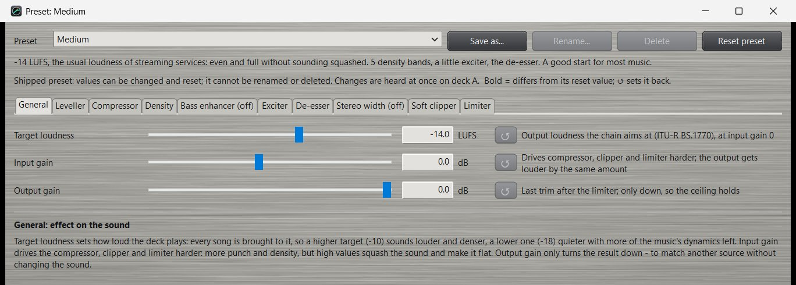

Click **Edit...** next to a deck's loudness preset. At the top:

- **Loudness** - the loudness preset shown; choosing another one here also moves the deck it was opened from to it.
- **Save as...** saves the current values under a new name; the deck moves to the new loudness preset.
- **Rename...** and **Delete** - for your own loudness presets only. Deleting a loudness preset moves the decks that used it to Medium.
- **Reset loudness** - back to the shipped values (for an own preset: to the general defaults).
- Under it, what the loudness preset does to the sound, and "Some values are changed" when they differ from the shipped ones.

Below that, a **tab per stage**. A stage that is switched off says "(off)" on its tab. On each tab:

- The stage's **On** check box first.
- A row per value: name, **slider**, the **value** (it can be typed - press Enter or leave the field; a comma counts
  as the decimal sign), the unit, a small **reset** button (back to the reset value; only enabled when the value
  differs, and its tooltip names the reset value) and a short explanation. A value in **bold** differs from its reset
  value. The row's tooltip has the full explanation and the range.
- Under the rows, what the stage does to the sound and what more or less of its values sounds like.

The window can be made as large as you like; it cannot be made smaller than the size that shows every row of the
largest tab and all texts in full (a narrower window is taller, because its texts take more lines).

Every change is heard at once; a dragged slider is saved when it is let go. Values outside the range are limited to
it; text that is not a value gives a warning. Times and frequencies that span a wide range move on a logarithmic
scale.

### 6.3 All values of a loudness preset

Defaults below are those of Medium (the general defaults of a new own preset).

**General**

| Value | Unit | Range | Default | What it does |
|---|---|---|---|---|
| Target loudness | LUFS | -24 .. -8 | -14 | The loudness every song is brought to (at input gain 0). Higher sounds louder and denser; lower keeps more dynamics. |
| Input gain | dB | -15 .. +18 | 0 | Drives the compressor, clipper and limiter harder: more punch and density; the output gets louder by the same amount. High values squash the sound. |
| Output gain | dB | -15 .. 0 | 0 | A last trim after the limiter, only down, so the ceiling holds. To match another source without changing the sound. |

**Leveller** - the slow hand on the volume.

| Value | Unit | Range | Default | What it does |
|---|---|---|---|---|
| On | | | on | |
| Range | dB | 0 .. 15 | 9 | The largest boost or cut. Larger evens out bigger differences between songs. |
| Speed | dB/s | 0.1 .. 6 | 1.0 | How fast the gain may move. Higher reaches a new song's level sooner but can be heard as the volume drifting within a song. |
| Attack | s per 10 dB | 0.2 .. 20 | 1.0 | How fast the gain comes down when a song comes in clearly too loud (after a quiet intro or a break). Shorter: the loud part is down sooner; longer: a gentler turn of the knob. |
| Release | s per 10 dB | 0.2 .. 20 | 1.5 (Gentle, DAB+: 5) | How fast the gain goes up when the music is clearly too soft (a soft intro, a quiet song after a loud one), and to a new song after a pause. Shorter: on level sooner, but the rise is easier to hear; longer: a gentler turn of the knob. |
| Hold below | LU | 5 .. 20 | 10 | Holds the gain while the music is this far under the target: fades and pauses are not pumped up. A quiet part that stays this low for the Quiet wait without fading (a soft intro or verse, a breakdown) is levelled like the rest. |
| Quiet wait | s | 0.5 .. 10 | 1 (Gentle, DAB+: 3) | How long such a quiet part waits before it is levelled. Shorter: a soft intro comes up sooner; longer: the start of a breakdown or a fade is surer to be left alone. |

Attack and Release never move slower than Speed. After a pause (a stopped deck) the next song is caught up at the
Release speed (up) or the Attack speed (down). The defaults were chosen on 18 songs with soft intros: they bring such
an intro to the target about a quarter sooner than before, without a song coming in louder at its loud part.

**Compressor** - evens out the loud parts within a song.

| Value | Unit | Range | Default | What it does |
|---|---|---|---|---|
| On | | | on | |
| Threshold | LU | -10 .. +15 | +2 | Relative to the target: material louder than this is compressed. Lower = more compression. |
| Ratio | :1 | 1 .. 8 | 2.0 | How strongly. Higher is more even and more "in your face"; too much sounds flat and tired. |
| Knee | dB | 0 .. 12 | 6 | Width of the soft knee: wider starts more gently. |
| Attack | ms | 1 .. 100 | 10 | Short catches drum hits (less punch); longer lets them through (more punch). |
| Release | ms | 20 .. 1000 | 200 | Short sounds lively but can pump; long is smooth. |
| Side-chain high-pass | Hz | off, 5 .. 200 | 80 | Bass below this does not make the compressor work, so a heavy kick does not pull the whole mix down. |
| Make-up | dB | auto, 0 .. 12 | auto | Gain after compression. Auto keeps the target level unchanged. |

**Density** - the multiband stage.

| Value | Unit | Range | Default | What it does |
|---|---|---|---|---|
| On | | | on | |
| Bands | | 1 .. 7 | 5 | Number of frequency bands (1 = wide-band). More bands act more selectively: the bass no longer pushes the voice around. |
| Amount | % | 0 .. 100 | 40 | Strength: from 1:1 at 0 % to 4:1 at 100 %. |
| Down above | dB | 0 .. 12 | 3 | A band this far above its own recent level is turned down. |
| Lift below | dB | 0 .. 20 | 6 | A band this far below its recent level is lifted. |
| Maximum lift | dB | 0 .. 12 | 6 | The largest lift of a band. |
| Attack | ms | 1 .. 200 | 20 | Time to turn a band down. |
| Release | ms | 20 .. 2000 | 300 | Time to turn a band back up. |
| Split 1 .. 6 | Hz | 20 .. 16000 | per band count | The frequencies between the bands. Only the splits of the band count in use are shown; they always rise, at least 1.25x apart (moving one past its neighbour moves the neighbour). A new band count loads its default splits. |
| Band 1 .. 7 gain | dB | -12 .. +12 | 0 | A fixed gain per band: a multiband tone control. |

Default splits per band count: 2 bands 200 Hz; 3: 200 / 2500; 4: 120 / 600 / 4000; 5: 60 / 200 / 2500 / 6000; 6: 60
/ 200 / 800 / 2500 / 6000; 7: 60 / 150 / 400 / 1000 / 2500 / 6000 Hz.

**Bass enhancer**

| Value | Unit | Range | Default | What it does |
|---|---|---|---|---|
| On | | | off | |
| Frequency | Hz | 60 .. 160 | 100 | Bass below this gets overtones. Higher is more audible but boomier. |
| Amount | % | 0 .. 100 | 30 | Strength of the overtones; too much sounds muddy. |

**Exciter**

| Value | Unit | Range | Default | What it does |
|---|---|---|---|---|
| On | | | on | |
| Frequency | Hz | 1500 .. 8000 | 3500 | Highs above this are excited. Lower also brightens voices and snares (can turn harsh); higher only adds air. |
| Amount | % | 0 .. 100 | 15 | Strength; too much sounds hissy, especially on old or low-bit-rate recordings. |

**De-esser**

| Value | Unit | Range | Default | What it does |
|---|---|---|---|---|
| On | | | on | |
| Frequency | Hz | 3000 .. 10000 | 5500 | Where it listens and acts. |
| Threshold | LU | -30 .. 0 | -10 | Relative to the target: sibilance louder than this is reduced (4:1). Lower acts more often. |
| Maximum reduction | dB | 0 .. 12 | 6 | The largest reduction. Too much makes voices lisp and sound dull. |

**Stereo width**

| Value | Unit | Range | Default | What it does |
|---|---|---|---|---|
| On | | | off | |
| Width | % | 0 .. 200 | 100 | 100 % = as recorded, 0 % = mono, above 100 % wider (can sound hollow and loses power in mono). |
| Bass width | % | 0 .. 100 | 100 | Width of the bass below the split; 0 % = bass in mono. |
| Bass split | Hz | 40 .. 400 | 150 | Where the bass width starts. |

**Soft clipper**

| Value | Unit | Range | Default | What it does |
|---|---|---|---|---|
| On | | | on | |
| Drive | dB | 0 .. 9 | 2 | How hard peaks are driven into the rounded curve: more loudness and density, less punch; pushed hard it sounds rough. |

**Limiter**

| Value | Unit | Range | Default | What it does |
|---|---|---|---|---|
| On | | | on | |
| Ceiling | dBTP | -6 .. 0 | -1.0 | The highest true-peak level of the output. Lower leaves more room for converters and lossy encoders. |
| Release | ms | 10 .. 500 | 80 | Short recovers fast (louder, can distort the bass); long is cleaner but can duck the sound after a peak. |

Switching the limiter off removes the true-peak guarantee; the output is still clamped at full scale. With the
soft clipper on, it then holds the ceiling as a sample peak itself and clips about 1.5 dB under it (that keeps the
highs clean); between the samples the level can still rise over the ceiling. For a true-peak ceiling keep the
limiter on.

### 6.4 Tips

- Start with **Medium** and compare one step up or down; judge at the same listening volume.
- For mixed old and new music, a **colour** with auto tone (Oldies or Auto) usually does more for the balance than
  changing the loudness preset.
- If the volume seems to drift within songs, lower the leveller **Speed**; if new songs take too long to settle,
  raise it (or rely on catch-up after pauses).
- If the sound "breathes" or pumps, lengthen the compressor and density **Release**, or lower the density **Amount**.
- Watch the stage rows: a limiter that reduces more than a few dB all the time means the stages before it push too
  hard (lower input gain, clipper drive or target).

## 7. Colours and the colour window

### 7.1 The shipped colours

A colour holds only the tone. The leveller keeps the loudness on target, so a colour changes the balance, not the
volume.

| Colour | Values | Use |
|---|---|---|
| **Neutral** | everything off | The tone as it is. |
| **Warm** | bass +3, low-mid -1, treble -1.5 dB | Fuller and softer; bright or thin mixes, long listening. |
| **Bass+** | bass +5 dB | More bass, the rest unchanged. |
| **Less mid** | low-mid -3, presence -1.5 dB | Cleaner, less boxy; takes boom and harshness out of live and older recordings. |
| **Bright** | presence +2, treble +3 dB | Clearer and more open for dull recordings (sharp on bright ones). |
| **Vocal** | bass -1, low-mid -2, presence +2.5 dB | Voices forward: speech, vocals, karaoke. |
| **Oldies** | auto tone 70 %, sub bass 20 %, bass +1, treble +1 dB | Thin, flat old recordings of the 60s and 70s. |
| **Auto** | auto tone 100 % | Each song pulled towards a well-balanced production, up to 6 dB (treble 3 dB). |
| **Quiet** | contour 60 % | Listening at a low volume: deep bass and highs added so the music stays full. |

### 7.2 The colour window

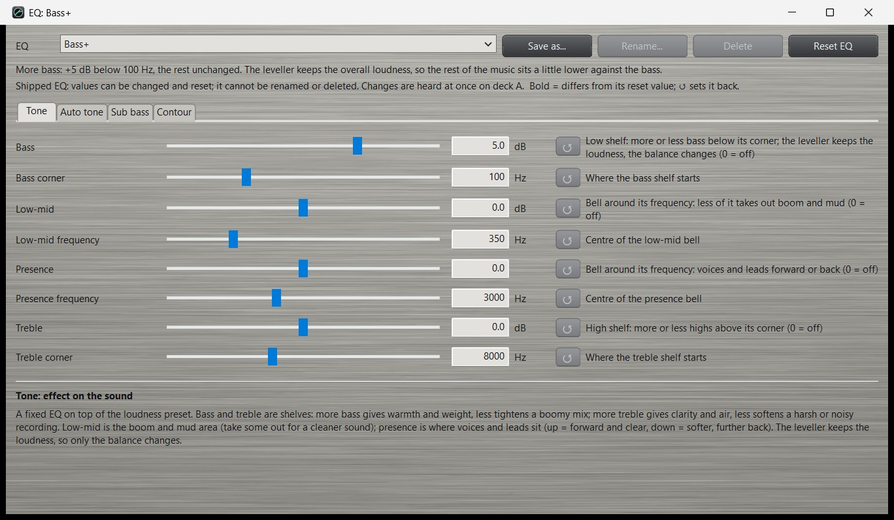

Click **Edit...** next to a deck's colour. It works like the loudness window (6.2): Save as, Rename, Delete (own
colours; deleting moves its decks to Neutral), Reset colour, and a tab per part. The colour window has no on / off
switches: a part with all its amounts at 0 is off.

### 7.3 All colour values

| Tab | Value | Unit | Range | Default | What it does |
|---|---|---|---|---|---|
| Tone | Bass | dB | -12 .. +12 | 0 | Low shelf: more or less bass below its corner (0 = off). |
| | Bass corner | Hz | 40 .. 250 | 100 | Where the bass shelf starts. |
| | Low-mid | dB | -12 .. +12 | 0 | Bell: less takes out boom and mud. |
| | Low-mid frequency | Hz | 150 .. 1000 | 350 | Centre of the low-mid bell. |
| | Presence | dB | -12 .. +12 | 0 | Bell: voices and leads forward or back. |
| | Presence frequency | Hz | 1000 .. 6000 | 3000 | Centre of the presence bell. |
| | Treble | dB | -12 .. +12 | 0 | High shelf: more or less highs above its corner. |
| | Treble corner | Hz | 3000 .. 16000 | 8000 | Where the treble shelf starts. |
| Auto tone | Amount | % | 0 .. 100 | 0 | How far each song's balance is pulled towards the reference (0 = off). |
| | Maximum | dB | 0 .. 9 | 6 | The largest correction of a band (treble: half of it - the top of an old recording is often its hiss). |
| | Time | s | 2 .. 60 | 10 | How long a band is measured before it is corrected; faster for the first seconds of a song. |
| Sub bass | Amount | % | 0 .. 100 | 0 | Adds a tone an octave below the bass. Use little: it is felt on large speakers and takes headroom. |
| | Frequency | Hz | 40 .. 120 | 80 | Bass below this is followed an octave lower. |
| Contour | Amount | % | 0 .. 100 | 0 | Equal-loudness contour for quiet listening: up to +9 dB deep bass and +4 dB highs. Leave it off at normal volume. |

The auto tone holds still during breakdowns and fades, so a quiet part does not change the sound.

## 8. The analysis and spectrum windows

### 8.1 The analysis window

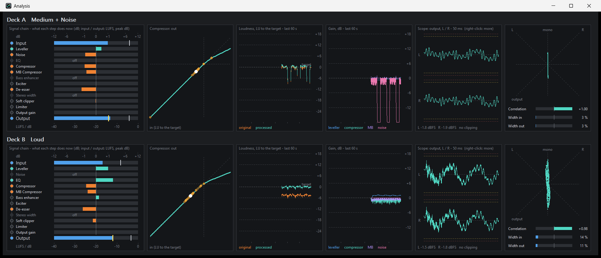

Click **Graphs** on a deck strip. The window has a row per deck with six panels:

1. **Signal chain** - a row per step in chain order, from *Input* to *Output*. Each step has a lamp (lit when the step
   changes the level by 0.1 dB or more; turquoise = up, orange = down) and a bar against a dB scale from -12 to +12
   (a square-root scale, so small changes are visible). The compressor, de-esser, clipper and limiter show their own
   gain reduction; the other steps show the level after the step against the level before it. *Input* and *Output*
   show the momentary loudness as a bar (-40 .. 0 LUFS) and the peak as a white mark; the output's target is the
   yellow mark. A step that is switched off says "off". **Click a row** to open that step's settings (the loudness
   window on its tab, or the colour window).
2. **Compressor** - the compressor's static curve for the loudness preset: output against input, in LU relative to the target
   (the dashed line is 1:1). The white dot is where the detector is now; amber dots show the last 3 seconds.
3. **Loudness** - the momentary loudness of the input (original, orange) and output (processed, turquoise) over the
   last 60 seconds, relative to the target.
4. **Gain** - the leveller, compressor and density gains over the last 60 seconds.
5. **Scope** - an oscilloscope of the waveform, left channel above and right below, to see whether the sound clips:
   50 ms across by default (a tone stands still: the picture starts at a rising zero crossing), or 1, 5, 10, 20 or
   200 ms, or the last 2 s (then each moment's highest and lowest sample). At 88.2 kHz and more the longest span the
   kept samples hold is shorter than 200 ms; the title then shows the span drawn. The scope shows the samples
   themselves (sample peak; the meters show the true peak). The red dotted lines are full scale (0 dBFS); red
   parts stood at full scale - that is clipping. Under the scope: each channel's peak and the clipped samples of the
   last 2 s, whatever the time across. For the output the yellow dotted lines are the limiter's ceiling, which the
   sound should stay inside. **Right-click** the scope for the *input* (orange: what comes in - clipping there is in
   the source) or the *output* (turquoise), and for the time across.
6. **Stereo** - a goniometer of the output (mono is the vertical line, left and right the diagonals), with bars for
   the output's correlation (+1 = mono, 0 = unrelated, negative = out of phase) and the stereo width of input and
   output (0 % = mono). They do not depend on the level: two decks with the same music show nearly the same values
   whatever their loudness presets. Only the Stereo width stage changes the width on purpose, and at Width 100 % (the
   default, "as recorded") it leaves it as it is - Width out then lies a percent or so under Width in, from the
   dynamics.

The history is cleared at every start of the audio.

### 8.2 The spectrum window

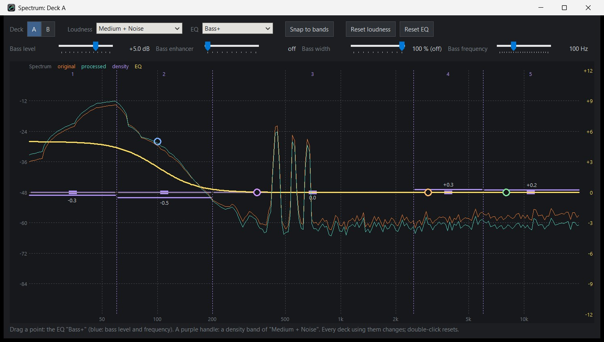

Click the **spectrum** in a deck's meter panel. The big graph shows, for one deck:

- The **spectrum** of the input (orange) and the output (turquoise), with its dB scale on the left. It reaches down
  to -96 dB; what is quieter is not drawn, so where a song has (almost) no highs the line drops out at the bottom.
- The **density bands** and their gains now: a purple line per band at its gain on the right-hand scale (above the
  0 dB line = lifted, under it = turned down), with the gain in dB.
- The deck's **colour as an EQ curve** (yellow, the right-hand scale in dB): thick - what the colour does now,
  including the auto tone's correction for this song; dashed - the same without the auto tone (only while it
  corrects); thin - each tone section on its own. A shaded block marks the sub bass's range.
- A **point per tone section**: bass (blue), low-mid (purple), presence (orange), treble (green). **Drag** a point:
  left and right change its frequency, up and down its gain, in the same steps as the colour window's sliders.
  **Double-click** a point to set its gain back to 0 dB. This changes the colour itself - every deck using it
  - is heard at once and saved when you let go of the mouse. The colour window and the bass sliders follow.
- A **purple handle per density band**: the band's fixed gain (*Band N gain* in the loudness preset's Density tab, -12 to
  +12 dB, right-hand scale), lying exactly over the band. **Drag** it up or down; **double-click** sets it back to
  0 dB. This changes the deck's loudness preset (every deck using it). So the density bands work as an EQ of their own, next
  to the colour's four tone sections.
- **Reset loudness** and **Reset colour** set every value of the deck's loudness preset or colour back, as the buttons in the
  loudness and colour windows do: a shipped one to its shipped values, your own to the defaults (asks first).
- **Snap to bands** (lit = on, remembered): a colour point dragged near a band split sits exactly on it (the split
  lights up), so a tone section can start where a density band does. A split outside a section's range is skipped.
- With two decks, **Deck A / B** switches between them. **Loudness** and **Colour** choose the deck's loudness preset
  and colour, as the lists in the main window do (both decks when they are linked).
- The **four bass sliders** (4.2) - bass level, enhancer, width and frequency - in a second row,
  for the deck shown, and the curve shows the change at once.
- The bass level and frequency **in the graph**: the blue bass point is the bass level (drag up or down) and the
  bass frequency (drag left or right; as the slider, it moves the enhancer's and the width's frequency too). The
  sliders at the top follow.
- The left scale (spectrum, dB) and the right one (colour, density, -12 to +12 dB) share the same grid lines.
- At the top right of the graph the window shows what is under the mouse: the frequency with the input, output and
  colour levels there, or the point's frequency and gain.

## 9. The plug-in for DJ software

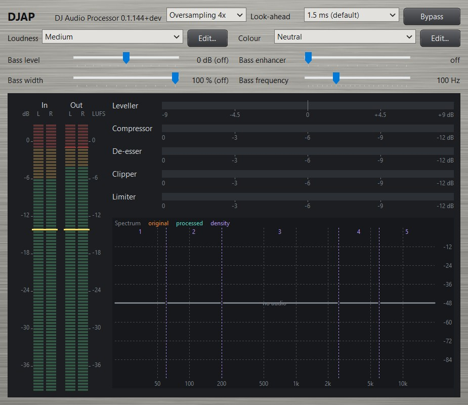

The plug-in brings DJAP's processing into DJ software (or any other program that loads plug-ins): one deck per
plug-in, stereo in and stereo out, with exactly the same chain, loudness presets and colours as the program. The DJ software
keeps the audio interface; DJAP only processes what passes through it.

### 9.1 Installing and finding it

Choose "Plug-in for DJ software" on the setup's "Select Components" page (it is chosen by default). It needs an
installation for all users (the normal one): the plug-in goes into the computer's plug-in folder,
`C:\Program Files\Common Files\VST3\DJAP\DJAP.vst3` (one file in a folder of its own), where DJ software looks for
plug-ins. If the DJ software does not
list "DJAP" yet, let it scan its plug-ins again (its settings usually have a button for that) and restart it.

Put one plug-in on each deck (as an effect of that deck or channel), or one on the master. The plug-in tells the
DJ software its delay (the look-ahead, 1.5 ms by default), so the DJ software can keep the decks in time.

The program and the plug-in can be installed and used together or apart.

### 9.2 The window

The window is one deck strip of the program:

- **Oversampling** - 2x, 4x (default) or 8x, as in the Setup window (5.1); stored with the DJ software's project.
- **Look-ahead** - the limiter's look-ahead, 0, 1.5, 2, 3 or 5 ms (see 5.1), a list of these five in the DJ software
  too; the DJ software is told the new delay. An old project's 0.5 or 1.0 ms runs as 1.5 ms.
- **Bypass** - lit: the input goes out unchanged, delayed by the same look-ahead.
- **Loudness** and **Colour** - the lists of the program (see 9.3), each with its **Edit...** button: the same loudness preset
  and colour windows as in the program (chapters 6 and 7), with every value, Save as, Rename, Delete and Reset.
- **The four bass sliders** (4.2).
- **The meter panel** - LED bars, the gain of each stage and the spectrum with the density bands and the colour curve, as in the main
  window (4.3). Clicking a stage's row or a column of bars opens the loudness window on that stage's tab, as in the
  program; clicking the spectrum opens its Density tab.

### 9.3 Loudness presets, colours and values

- The loudness preset and colour lists come from the program's settings file (`%APPDATA%\DJAP\DJAP.ini`): the shipped
  loudness presets and colours, and your own. Without the program the plug-in has the shipped ones, and works just the same.
- Loudness presets and colours made or changed in the plug-in's loudness window are saved in that same file, so the program
  and every plug-in share them. Program and plug-ins never overwrite each other's loudness presets: each saves only its own
  changes into the file as it is at that moment. The plug-in never changes the program's other settings. A loudness preset
  made in the program appears in the plug-in when its loudness window is opened (or when it is loaded).
- Choosing a loudness preset or colour loads its values. Choosing the one that is already chosen loads its values again -
  back to the loudness preset after changes. "(other values)" means the values match no loudness preset in the list (for example a
  project made on another computer).
- **Every value is a parameter** the DJ software can show and automate: the 72 values of the loudness preset and colour
  (named "Stage: value", for example "Compressor: Threshold", grouped by stage), the loudness preset and colour lists, Bypass
  and the look-ahead. They move in the same steps as the program's sliders.
- A **project** (or a preset of the DJ software) stores the values themselves, not only the loudness preset's name: it
  sounds the same on a computer where that loudness preset does not exist or was changed.

### 9.4 Updates

The plug-in is updated by the same setup as the program (chapter 11). If the DJ software has the plug-in loaded
during an update, the setup never closes the DJ software: the new plug-in takes the old one's place the next time
Windows starts.

## 10. Latency and real-time health

**Latency** is the time from the input socket to the output socket. It has three parts:

- the device's input buffer and output buffer (set by the buffer size; ASIO reports them exactly),
- the processing: only the limiter look-ahead (1.5 ms by default; 66 samples at 44.1 kHz) - the attack of every hit
  comes out after that, plus a fraction of a millisecond. The filters that split the spectrum let the lowest frequencies follow a few
  milliseconds later (Medium: about 6 ms at 100 Hz, 11 ms at 50 Hz; the technical manual, 1.5, lists each loudness
  preset), as in any multiband processor; both decks on the same loudness preset stay aligned.
- with an input on another clock (an ASIO output fed from a WASAPI / DirectSound / MME input, or WASAPI /
  DirectSound / MME with Drift correction): the drift buffer - the input's block plus the output's period plus
  3 ms, so about 8 ms at 128 frames and 23 ms at 10 ms periods. After a dropout of the input it grows by 2 ms (up to
  20 ms more) and shrinks again by 0.5 ms per quiet minute; the burst of sound a device sends after a hiccup can raise
  it for 20-40 seconds, and it then comes down slowly (0.3 ms a second, a speed change too small to hear) - after a
  long hiccup (100 ms) the buffer is back at its usual size after about 3 minutes. A device that
  hiccups again and again for 70 ms or more gives a dropout each time. With WASAPI Windows may run longer periods than the buffer size asked for (its low-latency mode
  takes only some sizes, at the device's own rate): the Setup window then says so, and the latency shown follows.

The Setup window shows the total.

**Health** (Setup window) shows whether the computer keeps up:

| Counter | Meaning |
|---|---|
| Periods | Audio periods processed since the start (or the last reset). |
| Heaviest / last | The processing time of the heaviest and the last period, in % of the period's length. |
| Over half their time | Periods that needed more than half of their time - a warning sign. |
| Late (dropout) | Periods not ready in time: you hear a dropout. |
| Answered with silence | The engine was not ready (for example while starting). |
| Driver resyncs, overloads | Reported by the ASIO driver. |

If late periods appear, raise the buffer size, close other heavy programs, or use fewer density bands. The processing
of both decks together uses only a few percent of one CPU core.

## 11. Updates

With "Check GitHub for a new version once a day" on (default), DJAP asks the project's public GitHub page about 15
seconds after it starts and then once a day. It only asks; it sends nothing about you or your computer beyond what any
web page request contains. GitHub answers its quick way of asking only 60 times an hour per network (every program
behind your router counts); when that is used up DJAP reads the release page itself instead, which GitHub does not
limit.

When a newer version exists, DJAP tells you once with a message at its notification-area icon, in the status bar and
in the About window. **Nothing is downloaded or installed until you click Install update** in the About window
(clicking the message opens it).

Install update:

1. asks first while the audio runs: the audio stops during the update (usually less than half a minute) and starts
   again by itself with the new version;
2. downloads the new setup and checks it against the SHA-256 checksum GitHub publishes for it - a setup that does not
   match, or has no checksum, is never run;
3. closes DJAP (with a fade-out) and runs the setup silently for the same folder; Windows may ask for permission;
4. starts DJAP again with your settings - and the audio, when it ran before. "Start with Windows" stays as you set it.

If something goes wrong the Setup window says what. The setup's log of the last update is in
`%TEMP%\DJAP-update\setup.log`.

## 12. The command-line program DJAPCmd

`DJAPCmd.exe` (in the installation folder) processes files offline with exactly the same code as the live program. It
never plays audio and never changes the settings. Open a command prompt in the installation folder, or give its full
path.

```
DJAPCmd --render <in> <out.wav> [--a <preset|off>] [--b <preset|off>] [--ca <colour>] [--cb <colour>] [--look <ms>] [--oversampling <2|4|8>] [--keep-delay] [--pcm24] [--trace <file.csv>]
DJAPCmd --presets
DJAPCmd --measure <file.wav> [more files]
DJAPCmd --tone <file> [more files]
DJAPCmd --devices
DJAPCmd --ini <file> ...     (use another settings file, read only)
DJAPCmd --version | --help
```

- **--render** processes a file. Input: WAV, or MP3 / M4A / WMA / FLAC through Windows Media Foundation (mono plays
  on both channels). A 2-channel file is deck A; a 4-channel file is deck A (channels 1-2) and deck B (3-4). Each deck
  uses its loudness preset and colour from the settings unless `--a` / `--b` (loudness preset, or `off` for unprocessed) and `--ca` /
  `--cb` (colour) say otherwise. The output is 32-bit float WAV (or 24-bit PCM with `--pcm24`), with the look-ahead
  delay removed (kept with `--keep-delay`: the file is then longer by the delay, so the look-ahead cuts nothing off the
  end - the filters' last few milliseconds of ringing after an abrupt end are still left out, about -35 dB); over 4 GB (about three hours of 4-channel 24-bit audio) it is written as
  RF64, the 64-bit form of WAV. The file is written under a temporary name first, so a failed render leaves no half
  file. A render holds the whole input and output in memory (about 3 times the size of a 24-bit file): fine for songs
  and sets, but a file of several GB needs that much free memory. `--oversampling` sets the clipper's and exciter's oversampling for this render (default: the settings'). After
  rendering it prints a report of input and output loudness.
  `--trace <file.csv>` also writes deck A every 100 ms: loudness in and out (momentary and short-term), the
  leveller's gain and whether it holds, and what the compressor, density bands, de-esser, clipper and limiter do -
  to see why a song comes out uneven. The trace file must be a file of its own (not the input or the output).
- **--presets** lists all loudness presets and colours with their main values and which deck uses them.
- **--measure** prints the integrated loudness, loudness range, maximum momentary and short-term loudness, sample
  peak and true peak of WAV files (per deck for 4-channel files).
- **--tone** prints each file's long-term tone balance (60 Hz, 250 Hz, 3 kHz and 10 kHz against 1 kHz) and what the
  auto tone would correct at 100 %.
- **--devices** lists the ASIO drivers and the WASAPI / DirectSound / MME devices without opening any of them; for
  each WASAPI input also the periods Windows' low-latency mode allows it (for Setup's *Input period*).

Example - process a song with the Loud loudness preset and the Oldies colour into a 24-bit file:

```
DJAPCmd --render song.mp3 song-loud.wav --a Loud --ca Oldies --pcm24
```

Exit code: 0 done, 1 wrong command line, 2 a file could not be read or written.

## 13. The settings file

All settings, the decks' choices and your own presets and colours are kept in one text file, `DJAP.ini`:

- next to the program when that folder is writable (a portable copy),
- otherwise (an installation in Program Files) in `%APPDATA%\DJAP\DJAP.ini`.

The About window shows which file is in use. DJAP saves it after every change. It can be read and edited by hand -
**only while DJAP is closed**. Sections:

| Section | Holds |
|---|---|
| `[Audio]` | Processing (`Decks`), API, driver, devices, channel pairs, rate, buffer, look-ahead, `StartAudio` (start the audio at program start), follow the Windows volume |
| `[Decks]` | Each deck's loudness preset, colour and processing switch, linked presets |
| `[Window]` | Where each window was last - position, size, maximised (a window opens there; without a line it opens in the middle of the screen) - and the window options |
| `[Updates]` | `CheckUpdates` (1 = the daily check is on) |
| `[Preset <name>]` | The values of a loudness preset that differ from its shipped values (own loudness presets: all values) |
| `[Colour <name>]` | The same for a colour |

To start over, close DJAP and delete (or rename) the file; DJAP starts with the shipped loudness presets and opens the Setup
window. Back the file up to keep your own loudness presets.

Settings of versions up to 0.1.57 (which had another program name) are copied once at the first start of DJAP; the
old file stays.

## 14. Troubleshooting

| Problem | What to do |
|---|---|
| **No sound** | Is the audio started (Setup window)? Are the right input and output pairs or devices chosen? Is a deck on *(none)*? Do the In bars move? If In moves and Out does not, check the output route and the amplifier. |
| **"Open driver" fails** | Another program (DJ software) may hold the ASIO driver. Close it or use another interface. Check that the interface is connected and its driver installed. |
| **A device shows "(not found)"** | The saved device is not connected, or it was chosen under another API (each API names devices differently). Choose it again. |
| **"The settings file could not be read"** at the start | Another program held `DJAP.ini` (a virus scanner, a sync tool) for more than two seconds. DJAP runs with its default settings and saves nothing, so your file stays as it is; close that program and start DJAP again. |
| **Dropouts, crackles** | Look at Health: late periods? Raise the buffer size; close heavy programs; set Windows' power plan to high performance; use fewer density bands. With an input on another clock, underruns in the Setup window mean the input fell behind: its buffer grows by itself, and shrinks again after a few calm minutes. |
| **The volume keys do nothing** | Switch on "The outputs follow the Windows volume" in the Setup window. |
| **The sound pumps or breathes** | Lower the density amount or the compressor ratio, lengthen their release, or choose a gentler loudness preset. |
| **A loud song starts too loud after a quiet intro** | That is the leveller's 3 s memory; "Attack" (Leveller tab) brings it down within about a second. Shorten it if needed - or lengthen Release or Quiet wait, so the soft intro is turned up less. |
| **A soft intro takes too long to come up** | Shorten "Quiet wait" (it starts sooner) and "Release" (it rises faster). A very soft intro (more than Range under the target) cannot be brought up fully: raise Range. |
| **Quiet passages come up too much** | A quiet part that stays is levelled after a few seconds. To keep more of the difference, lower the leveller range or its speed. |
| **A soft verse after a loud chorus stays too soft** | The leveller waits until the music has stopped falling (about 2-4 s) and then, when it is more than 4 dB too soft, comes up at the "Release" speed until it is within 1 dB. A shorter Release brings it up sooner, a larger Range further. |
| **Everything sounds too dull / too sharp** | Try another colour (Bright, Warm), or lower the exciter / de-esser. |
| **Limiter works hard all the time** | Lower the input gain, the clipper drive or the target, or use a quieter loudness preset. |
| **DJAP does not start with Windows** | Check the option in the Setup window and Windows' startup apps list. |
| **The update failed** | The Setup window says why; `%TEMP%\DJAP-update\setup.log` has the setup's log. The setup can always be downloaded from the GitHub page and run by hand. |
| **The DJ software does not list the plug-in** | Was "Plug-in for DJ software" chosen in the setup, in an installation for all users? Is `C:\Program Files\Common Files\VST3\DJAP\DJAP.vst3` there? Let the DJ software scan its plug-ins again and restart it. The DJ software must be 64-bit. |
| **The plug-in's loudness preset list lacks my own loudness presets** | The plug-in reads the program's settings in `%APPDATA%\DJAP\DJAP.ini` when it is loaded and when its loudness window is opened: click Edit... once, or load the plug-in again. A portable program (settings next to `DJAP.exe`) is not seen. |
| **DJAP closed unexpectedly** | Start `DJAP.exe --diag <file.txt>` from a command prompt; when it happens again, the file holds a report that helps to find the cause. |

## 15. Glossary

| Term | Meaning |
|---|---|
| **LUFS** | Loudness Units relative to Full Scale: loudness measured as the ear hears it (ITU-R BS.1770). -14 LUFS is louder than -18 LUFS by 4 LU. |
| **LU** | Loudness Unit: a difference in loudness; 1 LU = 1 dB. |
| **Momentary / short-term / integrated loudness** | Loudness over 0.4 s, over 3 s, and over a whole programme. |
| **dBFS** | Level relative to digital full scale (0 dBFS = the largest sample value). |
| **True peak, dBTP** | The peak of the waveform between the samples, as a converter or encoder rebuilds it; it can be higher than the highest sample. |
| **Ceiling** | The highest level the limiter lets through. |
| **Look-ahead** | The limiter delays the audio slightly so it sees a peak coming and can turn down smoothly before it arrives. |
| **Threshold, ratio, knee, attack, release** | Where a compressor starts, how strongly it works, how gradually it starts, how fast it reacts and how fast it lets go. |
| **Multiband** | Processing the audio in separate frequency bands. |
| **Bypass** | The deck's input goes out unprocessed. |
| **ASIO** | A low-latency audio driver standard for audio interfaces. |
| **WASAPI** | Windows' own audio system; *exclusive* mode takes a device for one program. |
| **Pre-fader** | A signal taken before the mixer's channel fader, so fader moves do not change it. |
| **Goniometer** | A stereo display: mono is a vertical line, wide stereo a cloud. |
| **Correlation** | How similar left and right are: +1 mono, 0 unrelated, -1 out of phase. |
| **Sample rate** | Measurements per second (44,100 Hz, 48,000 Hz); the highest frequency that can pass is half of it (3.5). |
| **Bit depth** | How finely each measurement is stored; about 6 dB of distance to the noise floor per bit (3.5). |

---

DJAP is free software under the GNU General Public License v3. ASIO is a trademark and software of Steinberg Media
Technologies GmbH.
